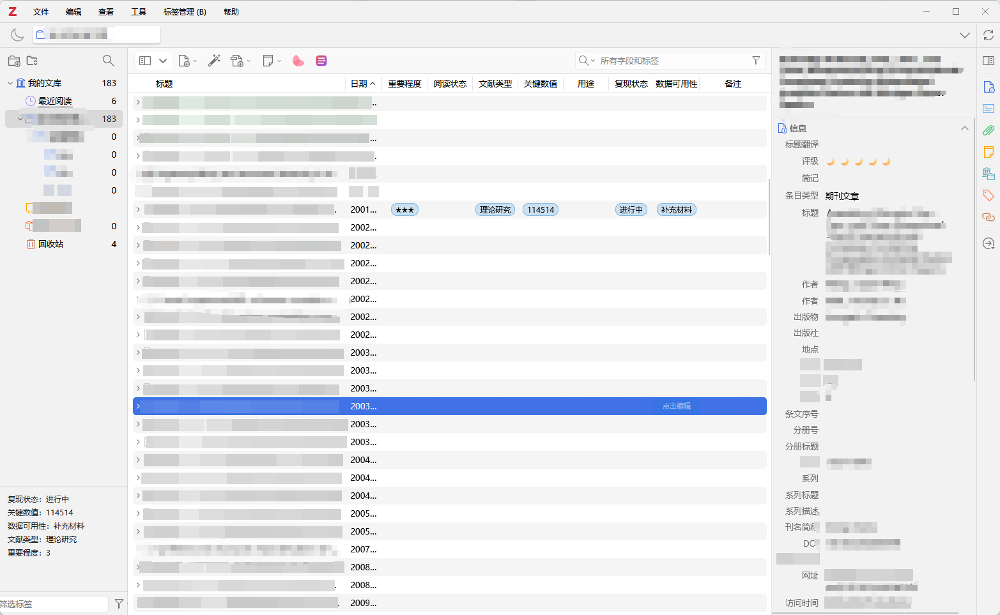

# Structured Tags for Zotero

## 简介 / Introduction

一个面向 Zotero 10 的可配置结构化标签插件。它把 Zotero 原生标签显示为文献列表中的独立列，并提供类似 Excel 单元格的编辑方式：添加列、双击修改列名、单击单元格修改值，以及使用单选或多选候选项进行文献批注。

A configurable structured-tag plugin for Zotero 10. It displays native Zotero tags as dedicated item-list columns and provides an Excel-like workflow: add columns, double-click a header to rename it, click a cell to edit its value, and annotate literature with single- or multiple-choice options.

## 界面预览 / Interface Preview



## 功能 / Features

- 在文献列表中显示自定义标签列 / Display custom tag columns in the item list
- 支持单选、多选、数值和文本字段 / Support single-choice, multiple-choice, numeric, and text fields
- 单击自定义单元格直接编辑 / Edit a custom cell with one click
- 批量修改所选文献 / Batch-edit selected items
- 自定义列名、候选选项、显示状态和排列顺序 / Configure names, options, visibility, and order
- 重命名字段时自动迁移已有原生标签 / Migrate existing native tags when a field is renamed
- 数据仍是 Zotero 原生标签，可随 Zotero 正常同步 / Keep Zotero native tags as the synchronized source of truth
- 在 Zotero 数据目录中实时维护独立 SQLite 镜像和变更历史 / Maintain a real-time SQLite mirror and audit history in the Zotero data directory
- 版本升级前执行高鲁棒性的字段匹配与保守迁移 / Run robust field matching and conservative migration before upgrades

默认字段仅作为通用示例，包括重要程度、阅读状态、文献类型、关键数值、用途、复现状态、数据可用性和备注。所有字段均可修改或删除。

The default fields are general examples: importance, reading status, literature type, key metric, usage, reproduction status, data availability, and remarks. Every field can be changed or removed.

## 数据安全与升级 / Data Safety and Upgrades

Zotero 原生标签始终是主数据，因此可以使用 Zotero 自身的同步功能。插件同时把结构化字段值实时镜像到 Zotero 数据目录下的 `structured-tags.sqlite`，并记录修改历史。数据库不放在程序安装目录中，避免 Zotero 更新或重装时被覆盖。

Native Zotero tags remain the source of truth and continue to use Zotero Sync. The plugin also mirrors structured values in real time to `structured-tags.sqlite` inside the Zotero data directory and records an audit history. The database is deliberately kept outside the application installation directory so Zotero upgrades or reinstalls do not overwrite it.

版本变化时，插件会先扫描已有配置、标签和本地字段目录。匹配依据包括稳定字段 ID、规范化名称、历史别名、字段类型兼容性、候选选项重合度、名称编辑距离和字符片段相似度。只有高置信度且与次优候选有足够差距的结果才会自动迁移；不确定结果只写入迁移日志，不会覆盖原始数据。

When the plugin version changes, it first scans the existing configuration, tags, and local field catalog. Matching considers stable field IDs, normalized names, recorded aliases, type compatibility, option overlap, edit-distance similarity, and character-token similarity. A migration runs automatically only when confidence is high and clearly exceeds the runner-up; uncertain matches are logged without overwriting source data.

## 安装 / Installation

1. 从 [GitHub Releases](https://github.com/WilliamWhite080808/zotero-structured-tags/releases) 下载最新的 `.xpi` 文件。 / Download the latest `.xpi` from GitHub Releases.
2. 在 Zotero 中打开“工具 → 插件”。 / Open **Tools → Plugins** in Zotero.
3. 点击右上角齿轮，选择“Install Plugin From File…”。 / Click the gear button and choose **Install Plugin From File…**.
4. 选择下载的 `.xpi` 文件并重启 Zotero。 / Select the downloaded `.xpi` and restart Zotero.

## 使用 / Usage

- 单击自定义字段单元格，直接修改该文献的对应值。 / Click a custom-field cell to edit that item.
- 打开“标签管理 → 编辑所选文献…”，批量编辑所选文献。 / Use **Tag Management → Edit Selected Items…** for batch editing.
- 打开“标签管理 → 字段与选项设置…”，修改列名、类型、选项、顺序和显示状态。 / Use **Tag Management → Field and Option Settings…** to configure fields.
- 双击自定义列表头，直接重命名该列。 / Double-click a custom column header to rename it.

## 本地构建 / Local Build

```powershell
.\build.ps1
```

构建产物位于 `dist/`，构建脚本会先验证清单。 / Build artifacts are written to `dist/`; the script validates the manifest first.

```powershell
node .\tests\validate-manifest.mjs
node .\tests\test-structured-tags.mjs
```

## 发布 / Publishing

完整的中英双语步骤见 [PUBLISHING.md](PUBLISHING.md)。 / See [PUBLISHING.md](PUBLISHING.md) for the complete bilingual workflow.

详细的数据镜像、评分权重、迁移阈值和冲突规则见 [MIGRATION.md](MIGRATION.md)。 / See [MIGRATION.md](MIGRATION.md) for mirroring behavior, scoring weights, migration thresholds, and conflict rules.

## 许可证 / License

[MIT](LICENSE)
